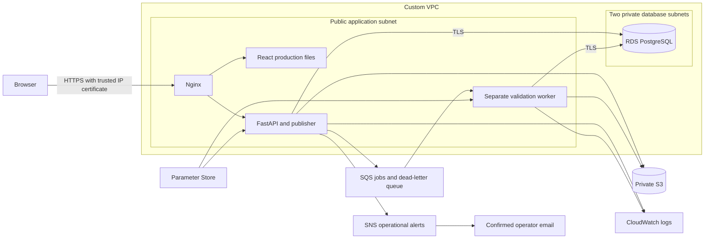

# DataGuard on AWS

This is the maintained deployment. It replaces the old instructions that asked
you to copy adapter implementations and create services manually. The adapters
already exist; this directory provisions and deploys the application itself.

## What gets deployed



The host is one Amazon Linux 2023 `t3.small` EC2 instance with a 20 GiB encrypted
disk and Elastic IP. Nginx serves the Vite production build and forwards `/api/`
without stripping its prefix. The API and worker run as separate non-root Python
3.13 containers managed by systemd. Docker Desktop is not required locally.

RDS is a private, encrypted, Single-AZ `db.t4g.micro` PostgreSQL instance with
20 GiB of gp3 storage, storage autoscaling limited to 30 GiB, one-day automatic
backups and deletion protection. One-day retention works with this account's
AWS free-plan restriction. The application uses its own database login, not
the RDS administrator.

There is no NAT Gateway or load balancer. The API and worker use the instance
role for S3, SQS, SNS, Parameter Store and CloudWatch. EC2 requires IMDSv2. SSH,
the database, and port 8000 are not publicly exposed; administration uses SSM.

Nginx serves browser-trusted HTTPS directly on the Elastic IP using a Let's
Encrypt IP-address certificate. HTTP serves the ACME validation path and redirects
application traffic to HTTPS. The database connection also uses TLS. No domain
purchase or CloudFront account verification is required.

IP-address certificates last about six days. A persistent systemd timer checks
renewal every six hours, reloads Nginx after renewal, and sends an SNS notice if
renewal fails. Certificate files remain on the encrypted instance disk across
application releases. Keep the instance running so automatic renewal can work;
after a long stop, renew its certificate before expecting trusted HTTPS.

This is a small project deployment with one application host and a Single-AZ
database. It has a maintenance window during application updates and does not
provide high availability.

## First deployment

From the repository root in Windows PowerShell:

```powershell
aws login --region ap-south-1
aws sts get-caller-identity --region ap-south-1
backend/.venv/Scripts/python.exe -m pip install -r deploy/aws/requirements.txt
backend/.venv/Scripts/python.exe deploy/aws/deploy.py --region ap-south-1 --operator-email YOUR_EMAIL
```

For Linux/macOS, substitute your Python virtual environment executable.
Use `--profile NAME` when the credentials belong to a named AWS profile.
The deployment creates billable resources. It never upgrades an AWS account
plan, buys a domain, deletes unrelated resources or pushes repository changes.

The command:

1. Builds the frontend with `npm ci`, runs frontend unit tests and selects API
   mode explicitly. A build manifest prevents a demo build being deployed.
2. Creates an archive from an explicit source allowlist. `.env`, `.git`, local
   uploads, AWS credentials, node_modules, and virtual environments are excluded.
3. Validates and creates the CloudFormation stack, including the custom VPC,
   private database, buckets, queues, topic, EC2 role/instance,
   CloudWatch logs, alarms and optional budget/email subscription.
4. Generates stable random application credentials in Parameter Store. Reruns
   preserve these values. No credentials are hardcoded or written into inventory.
5. Uses SSM to install the release. RDS's managed administrator secret is
   transported in a short-lived encrypted S3 object, streamed to a bootstrap
   container, then its exact S3 version is deleted in `finally`. The instance
   role does not have Secrets Manager administrator-secret access.
6. Creates the application database login, runs Alembic migrations, installs
   systemd services and Nginx, and checks database readiness.
7. Obtains the HTTPS certificate and verifies actual account creation, login, good and
   dirty uploads, reports, all four S3 downloads and cross-account isolation.
8. Stops the worker to confirm the API still publishes queued work, resumes it,
   restarts the application services, verifies persistent results, and checks
   that the SNS outbox contains delivered notifications.

AWS provisions RDS and EC2 asynchronously; first creation can take
15–30 minutes. The process prints progress. A failed command reports the stack
or SSM command to inspect. Check whether an operation is still running before
starting another deployment.

Successful output includes the live HTTPS URL. The inventory and verification
results are saved to `deploy/.state/dataguard-prod.json`, which Git ignores.
Register your own account on the website, create a rule set using the student
preset, then upload a sample CSV. No shared account or default password is
installed. Automated verification leaves only synthetic accounts and fixtures.

## Monitoring and costs

API and worker logs go to the inventory's CloudWatch log group with a 14-day
retention period; RDS PostgreSQL logs also have 14-day retention. Alarms cover an old queued job, dead-letter messages and EC2
status-check failure. Dirty completed jobs and failed jobs generate SNS notices.
Confirm the SNS subscription email before expecting operational email alerts.

Supplying `--operator-email` also creates an **account-wide $25 monthly cost
budget**, with email alerts at 80% and 100% actual spend and 100% forecast spend.
This budget includes other activity in the account. A budget sends alerts; it
does not stop resources or cap spending. Credits and free-plan eligibility do
not make every resource free. EC2, RDS, EBS, public IPv4, backups, requests,
traffic, secret storage and logs can incur costs. Review AWS Billing directly.

The queue visibility timeout is 180 seconds, longer than the 120-second worker
lease. Messages redrive to the DLQ after five receives. Files remain private;
authorized download links are temporary S3 Signature Version 4 URLs.

## Updates and verification

Use the same command and stack name to update. Include `--operator-email` again
to preserve the CloudFormation-managed email subscription and budget. Stack
updates are reviewed programmatically and automatic replacement/removal of the
database or data bucket is refused. Application releases use new directories;
the image build finishes before the running services are stopped.

```powershell
backend/.venv/Scripts/python.exe deploy/aws/template.py
backend/.venv/Scripts/cfn-lint.exe deploy/aws/cloudformation.json
Push-Location backend
.venv/Scripts/python.exe -m pytest --basetemp=runtime/pytest-aws
Pop-Location

# API verification only; creates new synthetic accounts and jobs.
backend/.venv/Scripts/python.exe deploy/aws/verify.py https://YOUR_ELASTIC_IP

# Real browser verification of signup, rule creation, upload, report and download.
$env:DATAGUARD_URL='https://YOUR_ELASTIC_IP'
Push-Location Frontend
npx.cmd playwright test --config playwright.aws.config.js
Pop-Location
```

`--skip-build` reuses the existing verified API build. Use it only when no
frontend source has changed. No secrets, signed URLs or authentication traces
are written to the verification report. Browser screenshots go under the
gitignored `Frontend/test-results/` directory.

## Operations and recovery

Find identifiers in `deploy/.state/dataguard-prod.json` or CloudFormation outputs.
Useful AWS commands:

```powershell
aws cloudformation describe-stack-events --stack-name dataguard-prod --region ap-south-1
aws ssm describe-instance-information --region ap-south-1
aws logs tail /dataguard/dataguard-prod/application --region ap-south-1 --since 15m
aws cloudwatch describe-alarms --region ap-south-1 --alarm-name-prefix dataguard-prod
```

Use SSM Run Command (`AWS-RunShellScript`) for host commands:

```bash
systemctl status dataguard-api dataguard-worker nginx --no-pager
cloud-init status --long
docker images
curl --fail http://127.0.0.1:8000/api/ready
nginx -t
journalctl -u dataguard-api -u dataguard-worker --since '15 minutes ago'
```

The installed release symlink is `/opt/dataguard/current`; old releases remain
under `/opt/dataguard/releases`. Configuration comes from the stack-specific
Parameter Store prefix. A secrets change requires restarting both services.
Source releases do not contain secrets. Schema migrations need a compatible
database rollback strategy; changing the source symlink does not undo schema
changes. If migration or readiness fails, inspect logs before restarting or
rolling back; the deployer does not silently claim an unsuccessful release.

If the first CloudFormation create rolls back, inspect the failed resource's
`ResourceStatusReason`. Do not repeatedly create new stacks: retained resources
still belong in the inventory. The initial account restriction encountered in
this deployment was RDS backup retention greater than the free plan permitted;
the template now uses one day. This account also requires support verification
for CloudFront, so the maintained deployment uses direct trusted HTTPS instead.
IAM/SSM propagation can also take a few minutes.

## Teardown

No teardown runs automatically. Save application data and any required
evidence first. The stack has termination protection; RDS has deletion
protection; RDS replacement/deletion makes a snapshot; buckets and application
logs are retained deliberately.

To remove the project after use:

1. Record stack outputs, export needed reports and decide which database backup
   to retain. Identify only resources managed by this stack.
2. Disable the database's deletion protection and the stack's termination
   protection. Delete the stack through CloudFormation.
3. Check the deletion result and resource events. Resolve any failed deletions
   before considering the stack removed.
4. Separately remove retained S3 objects **and every object version/delete
   marker**, then the two project buckets, if their data is no longer needed.
5. Remove retained application logs, stack-prefixed Parameter Store entries and
   unwanted final RDS snapshots. A final snapshot may continue to incur charges.
6. Verify that the EC2 instance, EIP, RDS instance, queues, topic, alarms, role,
   budget and VPC were removed. Check Billing after usage data has caught up.

Stopping EC2 alone leaves RDS and storage billing. Stopped RDS instances can
automatically restart. The inventory is essential for checking retained items;
never remove unrelated buckets or resources in the same AWS account.

## Files

| File | Purpose |
|---|---|
| `template.py` | CloudFormation template source |
| `cloudformation.json` | Generated, reviewable infrastructure template |
| `deploy.py` | Authenticated provisioning, packaging, SSM deployment and verification |
| `Dockerfile` | Python runtime used by the API, worker and migrations |
| `remote_install.sh` | Host service installation and readiness checks |
| `init_database.py` | Separate application database login bootstrap |
| `nginx.conf`, `proxy.conf` | Static frontend, API routing and HTTPS |
| `verify.py` | Public HTTPS application verification |
| `requirements.txt` | Local deployment tooling, including CLI-login support |

References: [Let's Encrypt IP certificates and Certbot](https://letsencrypt.org/2026/03/11/shorter-certs-certbot),
[RDS-managed administrator secrets](https://docs.aws.amazon.com/AmazonRDS/latest/UserGuide/rds-secrets-manager.html),
[AWS CLI sign-in](https://docs.aws.amazon.com/cli/latest/userguide/cli-configure-sign-in.html).
