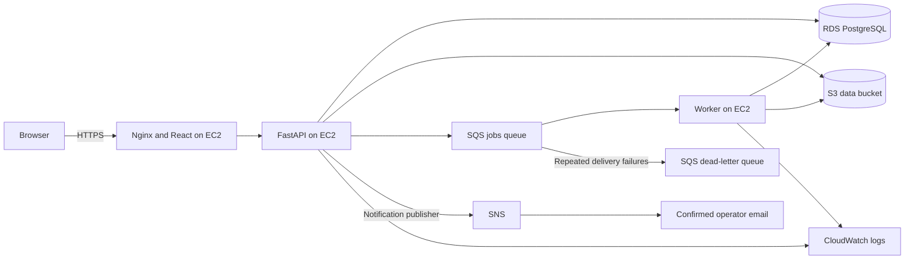

# DataGuard: Mini-project viva demonstration guide

This guide explains what to open, what to do, what result to expect, and what to say while demonstrating the deployed project. Allow 12–15 minutes for the main demonstration and another 5 minutes for questions.

Resource names below come from the deployment verified on **26 October 2026**. This document does not claim a fresh health check. If the deployment is recreated, use **CloudFormation → dataguard-prod → Outputs** to find its new identifiers.

## 1. Prepare before the viva

- Open the application: **https://13.234.189.176**. The application runs on AWS; you do not need to start the backend or frontend on your laptop.
- Sign in to the AWS Console and choose **Asia Pacific (Mumbai), ap-south-1**.
- Use a demonstration account and synthetic student records.
- Keep [students_dirty.csv](../samples/students_dirty.csv) and [students_good.csv](../samples/students_good.csv) ready on your laptop.
- In the application, create a rule set called **Student Records** using the default student rules. Keep these rules unchanged for the expected results below.
- Confirm the latest AWS SNS subscription email sent to the configured operator email address. The subscription was pending at the last recorded verification; check its current status before promising an email demonstration.
- Open separate tabs for the application, CloudFormation, EC2, RDS, S3, SQS, SNS, and CloudWatch. Open IAM, VPC, Systems Manager, Secrets Manager, and Budgets if time permits.
- Rehearse the commands below once. Commands marked **EC2 terminal** run in the AWS browser terminal, not Windows PowerShell.
- Avoid displaying passwords, secret values, tokens, or unrelated account information. The database queries below deliberately omit password hashes.

Reloading the application requires signing in again because the login token is held in browser memory. Saved accounts, rules, and jobs remain on the server.

## 2. Opening explanation: 30 seconds

> “DataGuard is a cloud-based CSV data-quality validation system. A user creates validation rules and uploads a CSV. A background worker checks the records, separates valid and rejected rows, and generates a report. AWS provides compute, persistent storage, asynchronous processing, monitoring, and notifications.”



The API and worker are separate processes on the same EC2 instance. RDS holds structured records; S3 holds file contents. Infrastructure is defined in CloudFormation.

## 3. Main demonstration order

| Time | Show | Evidence |
|---|---|---|
| 0–1 min | Architecture and CloudFormation | Resources belong to one reproducible deployment |
| 1–4 min | Application registration, rules, dirty CSV and report | Complete user workflow |
| 4–6 min | RDS records | Account, file metadata and job results persisted |
| 6–8 min | S3 objects | Original CSV and generated outputs exist |
| 8–10 min | EC2 and SQS | Running services and queued background processing |
| 10–12 min | SNS and CloudWatch | Notifications and operational evidence |
| 12–15 min | Security, configuration and budget | Private data access and cost awareness |

## 4. CloudFormation: show the deployment

**Open:** CloudFormation → Stacks → `dataguard-prod`.

1. Show the stack status. The last verified status was `UPDATE_COMPLETE`; a healthy deployment should have a completed create/update status.
2. Open **Resources** and identify EC2, RDS, S3 buckets, SQS queues, SNS topic, and alarms.
3. Open **Outputs** to show the website URL and resource identifiers.
4. If asked about source code, show [template.py](../deploy/aws/template.py) and [deploy.py](../deploy/aws/deploy.py).

**Say:** “Infrastructure as code describes the services and their connections. It makes the environment reproducible and keeps the deployment configuration in the project.”

Do not run an update or delete the stack during the viva.

## 5. Application: demonstrate the project working

**Open:** https://13.234.189.176

1. Register a fresh demonstration account, then sign in.
2. Create the **Student Records** rule set using the default student rules.
3. Explain required values, unique student identifiers, allowed departments, and age validation using the visible rules.
4. Upload `students_dirty.csv`, select the rule set, and submit it.
5. Open the completed job and show the summary, rejected rows, and validation reasons.
6. Download the valid CSV, rejected CSV, and JSON report.
7. Upload `students_good.csv` with the same rules and compare the result.
8. Show job history to demonstrate that previous results remain available.

| File | Total rows | Valid | Rejected | Valid percentage |
|---|---:|---:|---:|---:|
| students_dirty.csv | 6 | 2 | 4 | 33.33% |
| students_good.csv | 6 | 6 | 0 | 100% |

The UI may round 33.33% to 33.3%. These results depend on using the supplied files and default student rules.

**Say:** “Rejected records are separated with reasons so the user can correct their source data. A completed job can contain rejected rows; rejection is a data-quality result, not a server failure.”

## 6. RDS: show accounts, uploads and processing records

### Show the database infrastructure

**Open:** RDS → Databases → `dataguard-prod-database-sgo71swcn2r0`.

- Show engine **PostgreSQL** and current database status.
- In **Connectivity & security**, show that public access is disabled and inspect the attached security group.
- Show encryption and backup configuration. This deployment uses one-day automated backup retention.

**Say:** “RDS stores accounts, rule sets, upload metadata, job status, and results. The database is private and accepts application connections through its security group.”

### Show actual table rows

The RDS overview is an infrastructure screen, not an application table browser. Query the database through the application container, which already has a configured private connection.

**Open:** EC2 → Instances → `i-05fad34644a08a50b` → **Connect → Session Manager → Connect**.

Paste this entire block into the **EC2 terminal**. It only reads records:

```bash
sudo docker exec -i dataguard-api python - <<'PY'
from sqlalchemy import text
from app.database import get_engine

queries = {
    "ACCOUNTS": """
        SELECT id, email, created_at
        FROM users ORDER BY created_at DESC LIMIT 5
    """,
    "RULE SETS": """
        SELECT name, owner_id, created_at
        FROM rule_sets ORDER BY created_at DESC LIMIT 5
    """,
    "UPLOADED FILES": """
        SELECT original_name, size_bytes, storage_key, created_at
        FROM datasets ORDER BY created_at DESC LIMIT 5
    """,
    "JOBS AND RESULTS": """
        SELECT id, title, status, summary_json, created_at
        FROM jobs ORDER BY created_at DESC LIMIT 5
    """,
    "NOTIFICATION EVENTS": """
        SELECT job_id, event_type, status, sent_at
        FROM notification_events ORDER BY created_at DESC LIMIT 5
    """
}

with get_engine().connect() as connection:
    connection.execute(text("SET TRANSACTION READ ONLY"))
    for heading, query in queries.items():
        print("\n==========", heading, "==========")
        for row in connection.execute(text(query)).mappings():
            for key, value in row.items():
                print(f"{key}: {value}")
            print()
PY
```

**Expected:** Your new account appears in `users`; uploaded CSV names appear in `datasets`; jobs show their status and summary. Synthetic verification accounts may also appear.

For a before/after demonstration, run the block, create another upload through the application, then run it again. Match the new job ID and file name to the UI. The `storage_key` identifies the exact original file in S3.

**Say:** “The UI result has a corresponding persistent database record. The file itself is in S3, while this table stores its name, size, owner, and storage location.”

## 7. S3: show uploaded CSV files and generated outputs

**Open:** S3 → Buckets → `dataguard-prod-databucket-iamtiyhzaonu` → **Objects**.

```text
uploads/
  <account-id>/
    <dataset-id>/
      original.csv

outputs/
  <account-id>/
    <job-id>/
      valid.csv
      rejected.csv
      report.json
```

1. Use the `storage_key` from the database output to find the uploaded `original.csv`.
2. Select the object and show its size and last-modified timestamp.
3. Choose **Download**, then open the CSV in Excel or VS Code.
4. Navigate to `outputs/<account-id>/<job-id>/` for the demonstrated job.
5. Download `valid.csv`, `rejected.csv`, and `report.json` and compare them with the UI.
6. For the dirty sample, expect 2 valid data rows and 4 rejected data rows, excluding CSV headers.
7. Under **Permissions**, show Block Public Access. Under **Properties**, show encryption and versioning.

The original upload is renamed to `original.csv` in storage; its user-facing original filename remains in RDS. S3 “folders” are object-key prefixes.

**Say:** “S3 stores the original dataset and generated reports as private objects. Authorized application downloads use temporary signed links.”

Also show `dataguard-prod-artifactbucket-ykklakyguoop` briefly: this separate bucket stores deployment release packages. It is not the user-upload bucket.

## 8. EC2, EBS and Elastic IP: show the running application

**Open:** EC2 → Instances → `i-05fad34644a08a50b`.

- Show the running state, instance type `t3.small`, and status checks.
- Show public Elastic IP `13.234.189.176`.
- Open **Storage** and the attached EBS volume to show the encrypted application disk.
- Open **Security** and show inbound ports 80 and 443. Port 80 supports certificate validation and HTTPS redirection; public application traffic uses HTTPS.

In the **EC2 terminal**, run:

```bash
sudo systemctl is-active nginx dataguard-api dataguard-worker
sudo docker ps --format 'table {{.Names}}\t{{.Status}}'
curl --fail http://127.0.0.1:8000/api/ready
```

**Expected:** All three services print `active`, API and worker containers are running, and readiness returns a successful response.

**Say:** “EC2 hosts the frontend web server, API, and background worker. Docker packages the Python services, while systemd manages their lifecycle. The Elastic IP gives the deployment a stable public address.”

## 9. SQS: demonstrate asynchronous processing

**Open:** SQS → Queues → `dataguard-prod-JobsQueue-a0atFrE93Ql1`.

Show its monitoring graphs and visible/in-flight message counts. A queue count of zero is normal when the worker finishes quickly. Counts are approximate and graphs can lag.

**Say:** “The API places a job reference in SQS. The worker receives it and processes the file separately, so the upload request does not need to wait for the whole validation operation.”

### Optional controlled queue demonstration

This briefly pauses processing for all users. Use it only during your own rehearsal or demonstration when no one else needs the application. It is optional; historical metrics plus completed jobs are sufficient for a shorter viva.

1. In the **EC2 terminal**, schedule automatic recovery, then pause the worker:

   ```bash
   sudo systemd-run --on-active=2m /usr/bin/systemctl start dataguard-worker
   sudo systemctl stop dataguard-worker
   ```

2. Upload one CSV through the application. The API remains available; the job should reach `QUEUED` after dispatch.
3. Refresh SQS monitoring to show available work. Allow time for metrics to update. Do not poll, delete, or purge messages through the console during this demonstration.
4. Resume the worker immediately after showing the queue:

   ```bash
   sudo systemctl start dataguard-worker
   sudo systemctl is-active dataguard-worker
   ```

5. Show that the same job completes without uploading the file again. The automatic start scheduled in step 1 is a fallback; still run the manual start and verify `active` before moving on.

Then open `dataguard-prod-DeadLetterQueue-JoVCUEXYtu0d` and show the jobs queue's redrive configuration.

**Say:** “The dead-letter queue isolates messages that repeatedly fail delivery or processing. Ordinary invalid CSV rows are handled in a completed report and do not belong in the dead-letter queue.”

Do not deliberately cause failures or inject fabricated messages for the viva.

## 10. SNS: show operational notifications

**Open:** SNS → Topics → `dataguard-prod-OperatorsTopic-ARldMzsgog7R` → **Subscriptions**.

1. Show the email subscription and confirm that it is no longer `Pending confirmation`.
2. Complete a fresh CSV job through the application.
3. Show the matching notification in the subscribed inbox if it arrives. Check spam if necessary and allow for delivery delay.
4. Use the RDS query in section 6 to show the corresponding notification event.

**Say:** “The application records notification intent in the database, then publishes to SNS. SNS delivers notices to confirmed subscribers. Keeping notification delivery separate prevents an email failure from changing a completed validation result.”

A notification row marked `SENT` proves that the application successfully published to SNS. It does not by itself prove that the email reached the inbox. If subscription confirmation is pending, demonstrate the topic and database event and explain that limitation honestly.

## 11. CloudWatch: show logs and alarms

**Open:** CloudWatch → Logs → Log groups → `/dataguard/dataguard-prod/application`.

1. Open the `api` stream and recent events.
2. Open the `worker` stream and recent events.
3. Perform an upload and refresh the relevant streams to inspect recent activity. Use the job ID where it appears to connect logs with the demonstrated job.
4. Show the RDS log group `/aws/rds/instance/dataguard-prod-database-sgo71swcn2r0/postgresql`.
5. Show the 14-day log retention setting.
6. Open **Alarms → All alarms** and locate this stack's instance-health, queue-age, and dead-letter-queue alarms. Use CloudFormation Resources to locate generated alarm names.

**Expected:** Application log events are available; alarms show their current state. Explain `OK`, `ALARM`, or `INSUFFICIENT_DATA` based on the actual screen rather than promising a particular state.

**Say:** “Logs help diagnose individual requests and jobs. Metrics show system behavior over time, and alarms notify operators about instance problems, delayed work, or dead-letter messages.”

Do not trigger an outage just to make an alarm turn red.

## 12. VPC and security groups: explain private access

**Open:** CloudFormation Resources → locate `Vpc`, `AppSecurityGroup`, and `DbSecurityGroup`; follow their resource links.

- Show the application subnet and the two private database subnets.
- Show the application security group accepting public HTTP/HTTPS.
- Show the database security group accepting PostgreSQL port **5432 from the application security group**.
- Point out that public SSH and public database access are not enabled.

**Say:** “Network rules allow the application to reach PostgreSQL while keeping direct database access off the public internet. Two database subnets satisfy the subnet-group layout; this particular RDS instance is still Single-AZ.”

## 13. IAM, Systems Manager and Secrets Manager

| Service | What to show | What to explain |
|---|---|---|
| IAM | EC2 instance → Security → IAM role → attached policies | The instance uses a role to access the required buckets, queues, topic, parameters, and logs without static AWS access keys in source code. |
| Systems Manager Session Manager | The browser terminal used earlier | Administration works without exposing SSH to the internet. |
| Systems Manager Parameter Store | Parameters beginning `/dataguard/dataguard-prod` | Runtime configuration is stored outside application code; sensitive values use SecureString. Show names/types, not decrypted values. |
| Secrets Manager | The RDS-managed administrator secret metadata, linked from RDS or deployment outputs | RDS manages the administrator credential. The application uses a separate database login; the EC2 role does not read the administrator secret. |

**Say:** “IAM controls AWS service permissions, security groups control network access, and application authorization controls which user's jobs can be viewed. These are different layers.”

## 14. HTTPS and AWS Budgets

### HTTPS

Show the browser's connection information for the website and its certificate details.

In the **EC2 terminal**, optionally run:

```bash
sudo systemctl status dataguard-tls-renew.timer --no-pager
```

**Say:** “The website uses a trusted Let's Encrypt IP-address certificate. A timer checks renewal every six hours. This deployment does not use CloudFront or an Application Load Balancer.”

### Budgets

**Open:** Billing and Cost Management → Budgets → `dataguard-prod-monthly`.

Show the **$25 monthly account-wide budget** and notification thresholds: actual spend at 80% and 100%, plus forecast spend at 100%.

**Say:** “Budget alerts provide cost visibility. This budget covers the account and does not automatically stop services or cap spending.”

## 15. Common viva questions and short answers

| Question | Suggested answer |
|---|---|
| Why use both RDS and S3? | RDS handles structured, related records and transactions. S3 stores CSV and report file contents. |
| Why use SQS? | It separates accepting uploads from processing them and buffers work when the worker is unavailable. |
| Is SQS exactly-once processing? | Standard SQS can deliver a message more than once. The application uses job state and leases to coordinate work; deterministic output keys prevent duplicate output paths on retries. |
| What is the difference between SQS and SNS? | SQS holds work for consumers; SNS distributes notifications to subscribers. |
| Does a rejected row mean the application failed? | No. A completed validation can reject rows that violate rules and explain why. |
| Where are passwords stored? | Application password hashes are in RDS; plaintext account passwords are not stored. Infrastructure secrets are managed separately. |
| Can one user read another user's reports? | Application endpoints enforce ownership. Cross-account access was checked during deployment verification. |
| What happens if the worker stops? | The API can queue jobs. Processing resumes when the worker returns, subject to queue retention and retry limits. |
| What happens if EC2 restarts? | Services are managed by systemd. Persistent business records remain in RDS and files remain in S3. The website is unavailable while its only instance is down. |
| Is the deployment highly available? | No. This mini-project uses one EC2 instance and Single-AZ RDS. Multiple application instances and Multi-AZ RDS would be future improvements. |
| Does the system automatically scale? | The current compute deployment does not. The API/queue/worker separation allows future independent worker scaling. |
| Why use CloudFormation? | It records infrastructure configuration as code and makes deployments repeatable. |
| Is every AWS service demonstrated by causing a failure? | No. Healthy workflows demonstrate the application; configuration and metrics demonstrate supporting controls. |
| What are future improvements? | Multiple compute instances, Multi-AZ database, independent worker scaling, a custom domain, and stronger operational dashboards. |

## 16. If something does not work during the viva

| Symptom | First action |
|---|---|
| Website does not load | Check EC2 state/status checks and the three services in section 8. Do not disable certificate validation to hide an HTTPS problem. |
| Login disappears after refresh | Sign in again; this does not remove server-side records. |
| Job remains queued | Verify `dataguard-worker` is active, especially after the optional queue demonstration. Check worker logs. |
| SQS shows zero messages | Processing may already be complete. Show completed jobs and historical metrics, or use the controlled pause demonstration. |
| Cannot find a CSV in S3 | Use the database `storage_key` and ensure you opened the data bucket, not the deployment-artifact bucket. |
| SNS email does not arrive | Check subscription confirmation, spam, notification-event state, and delivery delay. Do not describe SNS publish success as confirmed inbox delivery. |
| CloudWatch graph looks empty | Select the correct region, resource, and recent time range; allow for metric delay. |
| Session Manager cannot connect | Check that the instance is running and managed by Systems Manager and that the signed-in identity can start a session. |

Capture genuine screenshots during rehearsal: completed dirty report, good report, RDS query output, S3 objects, queue metrics, CloudWatch events, and stack resources. If a live connection fails, clearly label these as earlier evidence rather than current live results.

## 17. Closing explanation

> “This demonstration traced a CSV from the browser through the API and queue to the background worker. We verified the structured records in RDS, the files in S3, and the operational evidence in CloudWatch and SNS. The deployment also uses private networking, IAM permissions, managed configuration, HTTPS, and budget alerts.”

Before finishing, verify the worker is active if you paused it. Close the administration session and leave the services running for normal application use.

## References

- [Deployment guide](../deploy/aws/README.md)
- [Recorded deployment verification](AWS_DEPLOYMENT_STATUS.md)
- [AWS: Start a Session Manager session](https://docs.aws.amazon.com/systems-manager/latest/userguide/session-manager-working-with-sessions-start.html)
- [AWS: SQS metrics and approximate counts](https://docs.aws.amazon.com/AWSSimpleQueueService/latest/SQSDeveloperGuide/sqs-available-cloudwatch-metrics.html)
- [AWS: Downloading S3 objects](https://docs.aws.amazon.com/AmazonS3/latest/userguide/download-objects.html)
